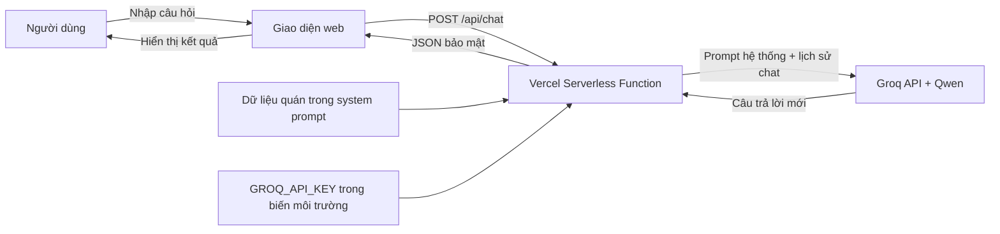
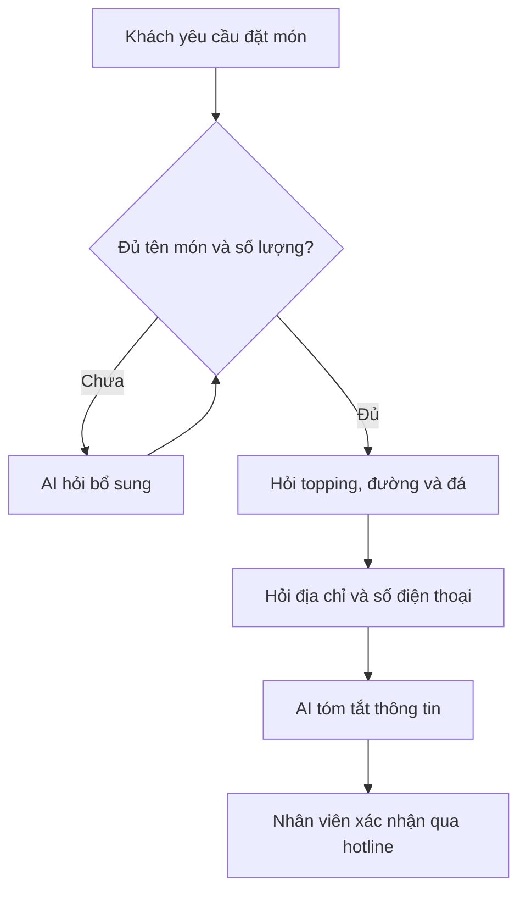

# Chương 2. Xây dựng AI Agent

## 2.1. Chức năng và vai trò

AI Agent “Nico” đóng vai trò trợ lý chăm sóc khách hàng của Trà sữa NicoLatBai. Agent có các chức năng:

- trả lời câu hỏi về thực đơn, giá, hương vị, topping, mức đường và đá;
- gợi ý món theo khẩu vị được mô tả bằng ngôn ngữ tự nhiên;
- cung cấp địa chỉ, giờ mở cửa, hotline và chính sách giao hàng;
- thu thập lần lượt thông tin cần thiết và tóm tắt đơn để nhân viên xác nhận;
- từ chối các nội dung ngoài phạm vi và không tự tạo dữ liệu chưa được quán cung cấp.

## 2.2. Công cụ và lý do lựa chọn

Hệ thống sử dụng nền tảng suy luận Groq Cloud với mô hình Qwen, frontend HTML/CSS/JavaScript, Vercel Serverless Functions và GitHub.

Groq Cloud được chọn vì có gói sử dụng miễn phí phù hợp với quy mô bài tập, tốc độ phản hồi nhanh và cung cấp API tương thích với chuẩn Chat Completions. Mô hình Qwen có khả năng hiểu hội thoại tự nhiên, tuân theo hướng dẫn hệ thống và tạo câu trả lời tiếng Việt theo từng tình huống. Khác với chatbot dựa trên câu trả lời định sẵn, mô hình kết hợp dữ liệu của quán với nhu cầu cụ thể của từng khách để tạo câu trả lời mới. Công cụ này cũng không trùng với Botpress Cloud, Gemini, Copilot hoặc Colab đã bị loại trừ trong yêu cầu đề tài.

Vercel được chọn thay cho GitHub Pages để khóa Groq được lưu ở biến môi trường phía máy chủ. GitHub Pages là hosting tĩnh; nếu gọi mô hình trực tiếp từ trình duyệt, API key sẽ bị lộ. GitHub vẫn được dùng để lưu mã nguồn, quản lý phiên bản và tự động kích hoạt triển khai trên Vercel.

## 2.3. Sơ đồ luồng hoạt động

Luồng đặt món:

## 2.4. Các bước cài đặt và “huấn luyện”

Trong đề tài này, “huấn luyện” được thực hiện bằng prompt engineering và cung cấp kho tri thức trong system prompt, không phải huấn luyện lại mô hình nền.

1. Tạo tài khoản Groq Console, mở trang API Keys và tạo một khóa miễn phí.
2. Chuẩn hóa dữ liệu quán: tên món, khoảng giá, mô tả vị, topping, địa chỉ, giờ mở cửa và giao hàng.
3. Viết system prompt trong `api/chat.js`, gồm vai trò, dữ liệu quán, quy trình đặt món, giới hạn phạm vi và quy tắc chống bịa thông tin.
4. Xây dựng giao diện trong `index.html`, định dạng bằng `styles.css` và xử lý chat trong `app.js`.
5. Tạo endpoint `/api/chat`: kiểm tra dữ liệu, ghép system prompt với lịch sử hội thoại, gọi Groq Chat Completions API và trả kết quả về giao diện.
6. Đẩy mã nguồn lên GitHub. Không commit file `.env` hoặc API key.
7. Import repository vào Vercel, thêm biến môi trường `GROQ_API_KEY`, sau đó Deploy.
8. Kiểm thử nhiều nhóm tình huống: hỏi thực đơn, xin gợi ý, đặt món thiếu thông tin, hỏi dữ liệu chưa có, câu hỏi ngoài phạm vi và prompt injection.
9. Điều chỉnh system prompt khi phát hiện câu trả lời chưa đúng, sau đó push lên GitHub để Vercel tự động cập nhật.

### Danh sách ảnh bắt buộc nên chụp

Đánh số ảnh thống nhất để đưa vào báo cáo:

1. Trang tạo API key trên Groq Console (che phần lớn khóa).
2. Cấu trúc repository trên GitHub với các file CSS, JS và API đã tách riêng.
3. Đoạn system prompt thể hiện dữ liệu và quy tắc của Agent.
4. Màn hình import GitHub repository vào Vercel.
5. Màn hình khai báo biến `GROQ_API_KEY` trên Vercel (không để lộ value).
6. Màn hình Vercel báo triển khai thành công và URL công khai.
7. Giao diện website trên máy tính và điện thoại.
8. Hội thoại AI tư vấn món theo khẩu vị.
9. Hội thoại đặt món nhiều lượt và phần tóm tắt cuối.
10. Hội thoại thử câu hỏi ngoài phạm vi để chứng minh Agent tuân thủ giới hạn.
11. Toàn bộ đoạn trao đổi với ChatGPT đã hỗ trợ xây dựng đề tài, đặt trong Phụ lục theo yêu cầu.

Mỗi ảnh cần có chú thích dạng “Hình 2.x – ...” và một đoạn 1–2 câu giải thích thao tác hoặc kết quả quan sát được.

## 2.5. Kịch bản tương tác thực tế

### Kịch bản 1 — Tư vấn theo khẩu vị

- Khách: “Mình muốn món thanh mát, chua nhẹ và không béo.”
- Agent dự kiến: đề xuất trà lài đác thơm hoặc trà dâu tằm, giải thích ngắn gọn và hỏi mức đường/đá.

### Kịch bản 2 — Ghi nhận đơn

- Khách: “Cho mình 2 trà sữa truyền thống.”
- Agent lần lượt hỏi topping, đường, đá, địa chỉ và số điện thoại; sau đó tóm tắt và nhắc đơn cần nhân viên xác nhận.

### Kịch bản 3 — Dữ liệu chưa xác định

- Khách: “Ship đến địa chỉ này hết chính xác bao nhiêu?”
- Agent không tự đoán; giải thích khu vực trên 3 km tính theo khoảng cách và hướng dẫn gọi hotline để xác nhận.

### Kịch bản 4 — Ngoài phạm vi

- Khách: “Viết giúp mình một bài luận.”
- Agent lịch sự từ chối và gợi ý quay lại nội dung thực đơn hoặc đặt món NicoLatBai.

## 2.6. Liên kết sản phẩm

- GitHub repository: `BỔ SUNG_LINK_GITHUB_SAU_KHI_PUSH`
- Website công khai: `BỔ_SUNG_LINK_VERCEL_SAU_KHI_DEPLOY`

Sau khi triển khai, thay hai dòng trên bằng liên kết thật và kiểm tra bằng cửa sổ ẩn danh để bảo đảm bất kỳ người dùng nào cũng truy cập được.

## Phụ lục — Quá trình sử dụng AI hỗ trợ đề tài

Đưa ảnh chụp toàn bộ cuộc trò chuyện với ChatGPT vào đây theo đúng thứ tự thời gian. Với mỗi nhóm ảnh, ghi rõ AI đã hỗ trợ phần nào (phân tích yêu cầu, kiến trúc, sửa mã, kiểm thử hoặc hướng dẫn triển khai) và sinh viên đã kiểm tra/chỉnh sửa kết quả ra sao.
